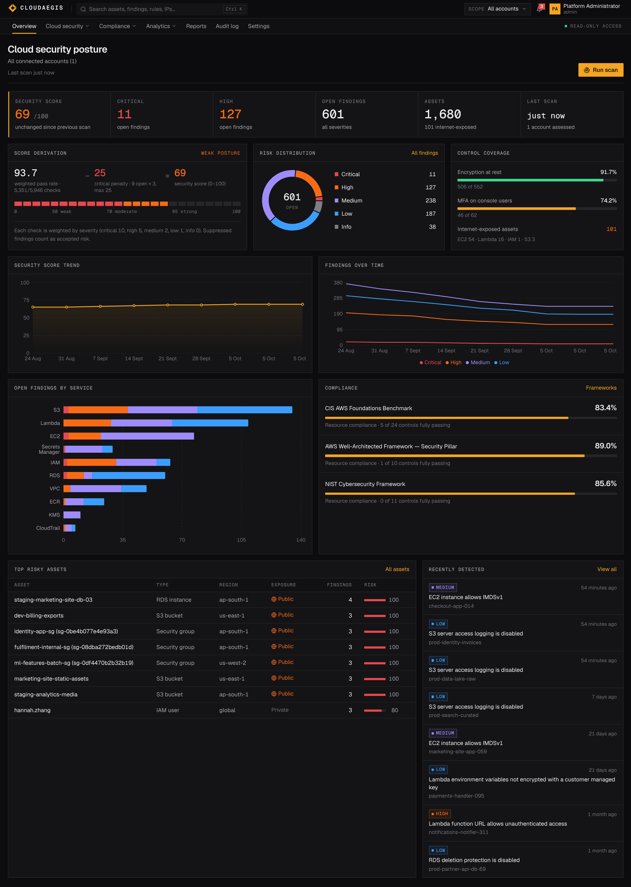
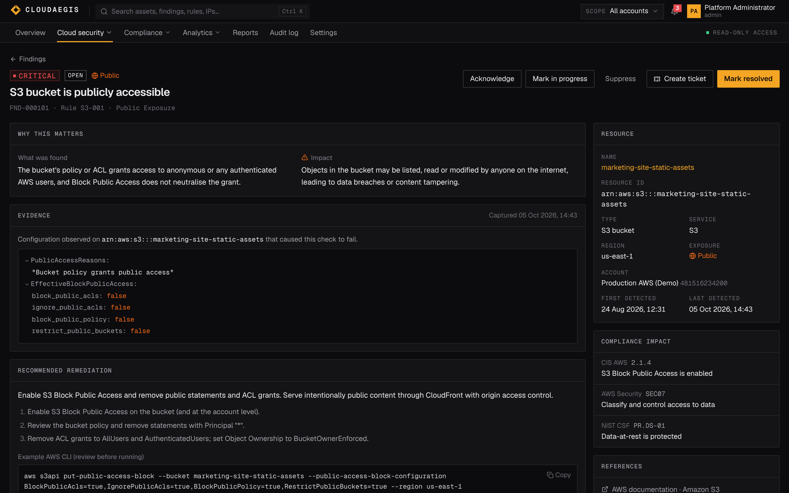
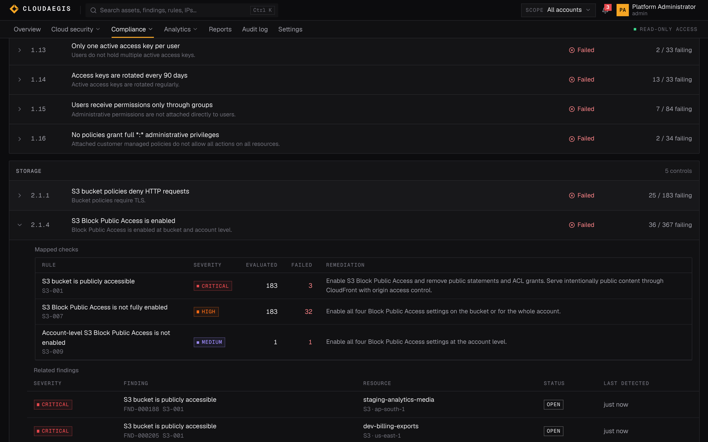
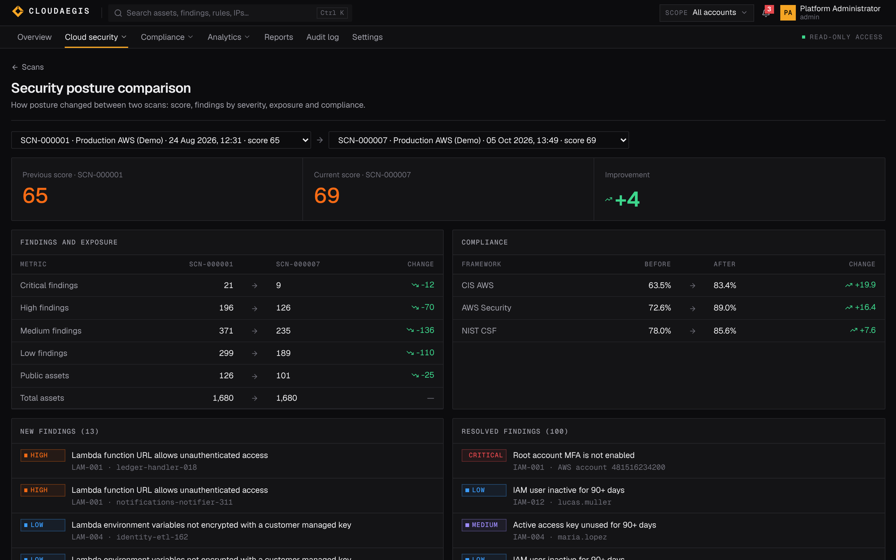
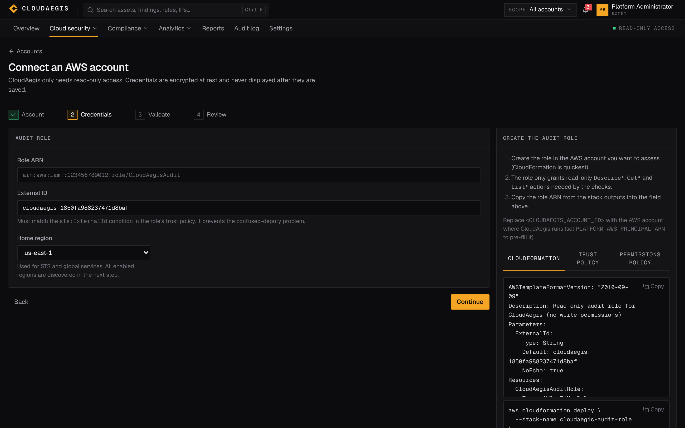
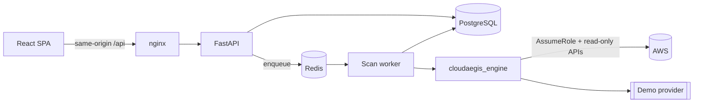

# CloudAegis

**Cloud Security Posture Management Platform**

CloudAegis continuously assesses AWS accounts for misconfigurations, excessive permissions, exposed resources, missing encryption and logging gaps. It maps every result to CIS AWS Foundations, AWS Well-Architected (Security) and NIST CSF, scores posture with a formula you can audit, and gives analysts an investigation workflow from finding to fix. It runs with **read-only** cloud access and never changes your infrastructure.



<table>
<tr>
<td></td>
<td></td>
</tr>
<tr>
<td></td>
<td></td>
</tr>
</table>

## Try it in two minutes

```bash
docker compose up --build
```

Open **http://localhost:8080** and pick a demo user on the sign-in page (password `CloudAegis!Demo2026`):

| User | Role | Can |
|---|---|---|
| `admin@cloudaegis.local` | Admin | everything, including users, accounts and settings |
| `analyst@cloudaegis.local` | Security analyst | run scans, triage findings, generate reports |
| `viewer@cloudaegis.local` | Viewer | read-only |

Demo mode connects a **simulated AWS account**, clearly labelled "Simulated" throughout the UI, with about 1,700 resources across 10 services and six weeks of scan history. No AWS account is needed. Its findings are not canned: they come from the real detection rules running against a simulated estate.

A walkthrough for reviewers: **Overview** → open a critical finding → read the evidence and remediation → follow its compliance mapping → **Scans** → compare the first and latest scans → **Reports** → generate an executive PDF.

## Features

| Area | What you get |
|---|---|
| **Onboarding** | Four-step wizard: name → IAM role (CloudFormation, trust policy and least-privilege policy generated with your external ID) or temporary STS credentials → connection test with region discovery → first scan. Long-lived keys are rejected. |
| **Discovery** | IAM (users, groups, roles, policies, keys, MFA), S3, EC2 (instances, security groups, ENIs, EBS, IMDS), VPC (subnets, routes, IGW/NAT, NACLs, flow logs), RDS, CloudTrail, Lambda, ECR, KMS, Secrets Manager. Resource relationships are captured. |
| **Detection** | [67 rules](docs/detection-rules.md) with evidence, impact, step-by-step remediation, CLI examples and references, e.g. public buckets, SSH/RDP open to the internet, IMDSv1, admin users without MFA, publicly assumable roles, privilege-escalation policies, unencrypted storage, disabled or single-region CloudTrail, public Lambda URLs, secrets in environment variables. |
| **Scoring** | 0–100 score = severity-weighted pass rate − critical penalty, [explained on screen](docs/security-model.md#security-score). Per-asset risk factors in internet exposure. |
| **Compliance** | CIS AWS Foundations 3.0, AWS Well-Architected Security, NIST CSF 2.0: passed, failed and not-applicable controls, resource-level compliance, related findings, trends. |
| **Findings** | Search, filters (severity, status, service, region, account, rule, framework/control, date, exposure), sorting and pagination in shareable URLs. Lifecycle: open → acknowledged → in progress → resolved / suppressed (justification required), bulk actions, comments, ticket drafts, full history. Findings reopen if they come back and auto-resolve when a scan proves them fixed. |
| **Inventory** | Every discovered asset with exposure, encryption, risk, related findings, configuration and relationship drill-down. |
| **Scanning** | Background workers (RQ/Redis), live per-service progress, cancellation, partial-failure handling, scan history and side-by-side comparison. |
| **Analytics** | Score, severity, compliance and exposure trends; MTTR; open-finding age; risk by service, region and category. |
| **Reports** | Executive and technical reports in PDF, JSON and CSV, each stored with a SHA-256 digest. |
| **Platform** | RBAC (admin, analyst, viewer), audit trail with filters, notifications, global search (assets, findings, rules, IPs, accounts, regions), configurable thresholds, per-rule enable/disable. |

## Architecture



The **security engine** (`packages/security-engine`) is a standalone library with no web or database dependencies:

- **Providers** implement `CloudProvider` and emit normalized `Resource`s. `AWSProvider` uses boto3; `DemoProvider` simulates an estate. Adding Azure or GCP means adding a provider and rule packs; nothing else changes.
- **Rules** are small classes registered in a `RuleRegistry`, each with structured metadata and its own PASS/FAIL tests.
- **Compliance** frameworks are data: controls reference rule IDs, so adding PCI DSS is a catalog entry.

Details: [docs/architecture.md](docs/architecture.md).

```
cloudaegis/
├── apps/
│   ├── backend/            FastAPI app: api/ core/ models/ schemas/ services/ workers/ + alembic/
│   └── frontend/           React + TS: components/ layouts/ pages/ services/ stores/ hooks/ lib/
├── packages/security-engine/cloudaegis_engine/
│   ├── providers/          base, aws/ (session, collectors, permissions), demo/
│   ├── rules/              base, registry, aws/{iam,s3,ec2,rds,cloudtrail,vpc,lambda_,kms,secretsmanager,ecr}.py
│   ├── checks/             policy and network analysers
│   ├── compliance/         catalog + evaluator
│   └── scoring/            security score and asset risk
├── tests/                  unit/ integration/ security/ fixtures/
├── docs/                   architecture, security model, detection rules, API, deployment
├── docker/                 backend + frontend Dockerfiles, nginx config
├── scripts/                dev.sh, test.sh, generate-secrets.sh, generate_rule_docs.py
└── docker-compose.yml
```

## Technology

**Backend:** Python 3.12, FastAPI, Pydantic v2, SQLAlchemy 2, Alembic, PostgreSQL 16, Redis + RQ, boto3, Argon2, PyJWT, cryptography (Fernet), ReportLab.
**Frontend:** React 18, TypeScript, Vite, Tailwind CSS, Radix UI primitives, Lucide, Recharts, TanStack Query, React Router, React Hook Form + Zod.
**Quality:** pytest, moto, Testing Library + Vitest, GitHub Actions, Docker Compose.

## Security of the platform itself

A CSPM holds keys to every account it audits, so CloudAegis applies its own standards: read-only least-privilege roles with external IDs; credentials encrypted at rest and never returned; Argon2id passwords; server-side sessions with idle and absolute expiry; CSRF tokens bound to the session; account lockout and rate limiting; strict CSP and security headers; allow-listed sorting and parameterised SQL; CSV-injection escaping; error responses that never leak internals; a complete audit trail; non-root containers; production startup that refuses insecure configuration.

See [docs/security-model.md](docs/security-model.md) for the full model and the tests behind each control.

## AWS setup

1. Give CloudAegis an identity that can call `sts:AssumeRole` (instance profile or task role preferred) and set `PLATFORM_AWS_PRINCIPAL_ARN`.
2. In **Accounts → Add account**, deploy the generated CloudFormation template in the target account. It creates `CloudAegisAudit`, trusted only with your external ID and limited to `Describe*`, `Get*` and `List*` actions.
3. Paste the role ARN, test the connection, pick regions, and start the first scan.

Full guide, including temporary credentials: [docs/deployment.md](docs/deployment.md#aws-setup).

## Configuration

All settings are environment variables, documented in [`.env.example`](.env.example). Key ones:

| Variable | Default | Purpose |
|---|---|---|
| `DATABASE_URL` | local PostgreSQL | SQLAlchemy URL |
| `REDIS_URL` | `redis://localhost:6379/0` | queue and rate limits |
| `SECRET_KEY` | dev value | signs session tokens (required in production) |
| `CREDENTIAL_ENCRYPTION_KEY` | derived in dev | Fernet key for stored cloud credentials (required in production) |
| `SCAN_EXECUTOR` | `inprocess` (`rq` in Docker) | where scans run |
| `DEMO_MODE` | `true` | seed the simulated account and demo users |
| `COOKIE_SECURE` | `true` | `Secure` cookies (set `false` for plain-HTTP local use) |
| `CORS_ORIGINS` | localhost | allowed browser origins |

## Testing

```bash
./scripts/test.sh          # everything below
python -m pytest           # backend: unit + integration + security (needs PostgreSQL for API tests)
cd apps/frontend && npx vitest run
```

| Suite | Count | Covers |
|---|---|---|
| `tests/unit` | 1,290 | every rule (pass, fail and n/a cases, thresholds), policy and network parsers, scoring, compliance evaluation, scan engine (resilience, cancellation, determinism), AWS provider against **moto**, read-only guarantee, backend crypto and config guards |
| `tests/integration` | 106 | every endpoint, filters, sorting and pagination, the scan workflow and comparison, finding lifecycle (reopen and scoped auto-resolve), reports, onboarding through moto, users and settings, **migrations match the models** |
| `tests/security` | 87 | 401 on every route, RBAC matrix, lockout, session revocation and expiry, forged tokens, CSRF binding, headers, CORS, rate limits, injection payloads, no secret or stack-trace leakage |
| frontend | 32 | API client, validation schemas, components, login and findings pages |

No test needs a real AWS account. API tests use a disposable PostgreSQL database (`TEST_DATABASE_URL`, default `cloudaegis_test`) whose schema is rebuilt with Alembic on every run.

## API

OpenAPI is generated by FastAPI at `/api/docs`. The API is versioned under `/api/v1`, uses one error envelope with request IDs, and supports pagination, filtering and sorting. Reference: [docs/api.md](docs/api.md).

## Deployment

`docker compose up` runs PostgreSQL, Redis, the API, a scan worker and the nginx-served UI. For production hardening (TLS, secrets, scaling, observability, upgrades), see [docs/deployment.md](docs/deployment.md).

## Roadmap

- Azure and GCP providers (the provider interface and resource model are ready)
- Attack-path analysis across network reachability and IAM trust
- AWS Organizations: auto-onboard member accounts with StackSets; SCP-aware evaluation
- Scheduled scans and event-driven rescans (EventBridge / CloudTrail)
- Jira and ServiceNow ticket integration; Slack and email alerts
- More frameworks: PCI DSS 4.0, ISO 27001, SOC 2
- SSO (OIDC/SAML) and SCIM provisioning
- Custom rules written as policy-as-code

## License

MIT. See [LICENSE](LICENSE).
