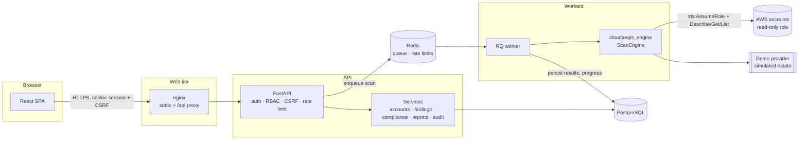

# Architecture

CloudAegis is a monorepo with three deployable pieces and one shared library:

| Path | What it is |
|---|---|
| `packages/security-engine` | `cloudaegis_engine` — provider adapters, normalized resource model, detection rules, compliance catalog, scoring. Pure Python, no web or database code. |
| `apps/backend` | FastAPI service: authentication, RBAC, persistence (PostgreSQL via SQLAlchemy + Alembic), scan orchestration, reports, audit trail. |
| `apps/backend` (worker mode) | The same image running an RQ worker that executes scans off the request path. |
| `apps/frontend` | React + TypeScript SPA (Vite, Tailwind, TanStack Query, React Hook Form + Zod, Recharts), served by nginx which also reverse-proxies `/api`. |



## Request path

1. The SPA calls `/api/v1/...` on the same origin; nginx proxies to the API, so session cookies stay `SameSite=Strict`.
2. `RequestContextMiddleware` assigns a request ID (or accepts a well-formed `X-Request-ID`), binds it to structured logs, and returns it on every response, including 500s.
3. `RateLimitMiddleware` applies a per-client budget (Redis-backed, in-memory fallback).
4. `get_auth` resolves the session (signed JWT + server-side session row), enforces idle and absolute expiry, and checks the CSRF header on state-changing requests.
5. `require(Perm...)` enforces RBAC per endpoint and records denied attempts in the audit log.
6. Services do the work; errors are raised as typed `AppError`s and rendered in one envelope: `{"error": {"code", "message", "details", "request_id"}}`.

## Scan pipeline

```text
POST /scans ──► scans row (QUEUED) ──► queue.enqueue(scan_id) ──► 202 Accepted
                                              │
                    worker: execute_scan(scan_id)
                      1. RUNNING; build provider from account config (+ decrypted credentials)
                      2. ScanEngine.run(regions, services, progress, should_cancel)
                           discovery:  provider.discover_service(service, regions) → Resources
                           evaluation: registry.for_type(resource_type) → RuleResults
                           posture:    exposure + encryption per resource
                      3. persist_results: upsert assets & relationships, open / reopen / auto-resolve
                         findings, per-rule stats, asset risk, score, compliance snapshot
                      4. COMPLETED / PARTIAL (some services denied) / FAILED / CANCELLED
                      5. audit event + notification on new critical findings
```

- **Progress** is written to the scan row at most every 0.75 s (`_ProgressWriter`), so the UI polls `GET /scans/{id}` for live per-service progress without hammering the database.
- **Executors**: `SCAN_EXECUTOR=rq` (Docker default) pushes jobs to Redis for one or more workers; `inprocess` uses a bounded thread pool for single-node use. Both keep the API responsive.
- **Cancellation** is cooperative: the engine checks a cancel flag between resources.
- **Resilience**: a service that returns AccessDenied marks only that service failed (scan becomes `PARTIAL`); a rule that throws is recorded in `rule_errors` and does not abort the scan.
- **Finding lifecycle**: findings are keyed by (asset, rule). A finding closes automatically only on evidence: its rule was re-evaluated on that resource and passed, or the resource disappeared from a scanned scope. Scans of a subset of services or regions never close findings outside their scope. A manually resolved finding that is detected again is reopened with a `reopened` event.

## Security engine

```text
cloudaegis_engine/
├── models.py            Resource, Inventory, RuleMetadata, RuleResult, Severity
├── resource_types.py    canonical type IDs (aws.s3.bucket, …) and service grouping
├── providers/
│   ├── base.py          CloudProvider interface, ConnectionResult, ServiceAccessError
│   ├── __init__.py      PROVIDERS registry + create_provider(kind, config)
│   ├── aws/             AWSProvider, session (AssumeRole / STS), per-service collectors, permissions
│   └── demo/            DemoProvider: deterministic simulated estate with the same resource shapes
├── rules/
│   ├── base.py          Rule base class, RuleContext (inventory + thresholds)
│   ├── registry.py      @register, RuleRegistry, default_registry()
│   └── aws/*.py         67 rules in 10 packs
├── checks/              shared analysers: IAM/resource policy parsing, network exposure, time
├── compliance/          framework catalog (data) + evaluator
├── scoring/             security score and asset risk
├── posture.py           public exposure and encryption status per resource
└── engine.py            ScanEngine orchestration
```

### Provider abstraction

The engine depends only on `CloudProvider`:

```python
class CloudProvider(ABC):
    def validate_connection(self) -> ConnectionResult: ...
    def account_id(self) -> str: ...
    def supported_services(self) -> list[str]: ...
    def discover_service(self, service: str, regions: list[str]) -> Iterator[Resource]: ...
```

Rules never see boto3 objects; they see normalized `Resource`s with documented property names. Adding Azure or GCP means writing a provider that emits resources (for example `azure.storage.account`), registering it in `PROVIDERS`, and adding rule packs for those types. The scan pipeline, persistence, scoring, compliance evaluation and UI are unchanged.

The **demo provider** implements the same interface and emits the same resource shapes as the AWS collectors, so every finding in demo mode is computed by the real rules, not hard-coded. A `maturity` parameter controls how many resources are misconfigured; resource identities are stable across maturity levels, which is how the seeded scan history shows a believable remediation trend.

### Rules

A rule is a class with metadata and one method:

```python
@register
class BucketVersioningDisabled(Rule):
    metadata = RuleMetadata(rule_id="S3-005", title="S3 bucket versioning is not enabled",
                            severity=Severity.MEDIUM, service="S3", resource_type=rt.S3_BUCKET, ...)

    def evaluate(self, resource, ctx):
        status = resource.prop("versioning", "Disabled")
        return self.check(resource, status != "Enabled", {"VersioningStatus": status})
```

Returning `None` means "not applicable" (for example, key rotation on an asymmetric KMS key). Rules can consult `ctx.inventory` for cross-resource decisions (is the CloudTrail bucket public? is this role used by a Lambda?). Every rule has PASS/FAIL tests in `tests/unit/rules/`, and a registry test fails if a new rule has no tests.

### Compliance

Frameworks are plain data (`compliance/catalog.py`): controls list the rule IDs that provide evidence. The evaluator turns per-rule `(evaluated, failed)` counts into control status (`PASS`, `FAIL`, `NOT_APPLICABLE`) and a resource-weighted compliance ratio. Adding PCI DSS or ISO 27001 is a new `Framework` definition.

## Data model

PostgreSQL schema (Alembic migration `0001_initial_schema`), with JSONB only for genuinely variable data (resource properties, evidence, progress):

| Table | Purpose |
|---|---|
| `users`, `roles`, `permissions`, `role_permissions`, `user_sessions` | identities, RBAC, server-side sessions (revocation, idle timeout) |
| `cloud_accounts`, `cloud_regions` | connected accounts, encrypted credential payload, enabled regions |
| `assets`, `asset_relationships` | inventory with exposure, encryption, risk; typed edges (attached_to, executes_as, …) |
| `security_rules` | rule catalog synced from the engine; enable/disable per rule |
| `findings`, `finding_events` | one row per (asset, rule) with lifecycle history |
| `scans`, `scan_results` | scan runs, progress, score breakdown, per-rule stats |
| `compliance_frameworks`, `compliance_controls`, `compliance_mappings` | catalog synced from the engine |
| `reports` | generated report files (bytes + SHA-256) |
| `audit_logs` | append-only audit trail |
| `notifications`, `app_settings` | in-app notifications; tunable thresholds and scan defaults |

Foreign keys cascade from accounts to their assets, findings and scans; list and filter paths (finding status/severity/service/region, asset UID, audit timestamp/action) are indexed. A test (`tests/integration/test_database.py`) asserts the migrated schema matches the models exactly.

## Frontend

- `src/services` — typed API client per resource; `src/lib/api.ts` handles CSRF and error normalisation.
- `src/stores` — auth session and the global account scope.
- `src/hooks/useUrlState` — filters, sorting and pagination live in the URL, so every view is shareable.
- `src/components/ui` — the design system (buttons, badges, tables, dialogs, states); `components/charts` wraps Recharts.
- Every data view handles loading, empty, error (with request ID and retry) and success states.
- Pages are code-split per route.
